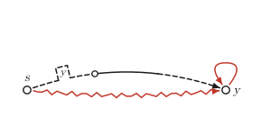
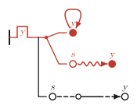
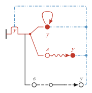

Frege-style formula trees and Kripke frame pictures from one text, drawn by Lean.

frege-diagrams is built around FGD, a small figure language. One text describes a figure, which is
a formula with layout hints, and from it the tool makes:

* **view A**, a frame picture: states and arrows of a Kripke frame;
* **view B**, a formula tree in the style of Frege's *Begriffsschrift*;
* the formula in LaTeX;
* in your own Lean development, a meaning to prove things about: the library
  gives figures none itself, but `fig_of%` lets a theorem speak about the very
  text that is drawn.

In view B the binding links from a quantifier to the states it binds are routed
with exact Steiner trees, and drawn dashed in Morse code so that links can be
told apart in black and white. The interactive editor `framedit` draws
everything with the same Lean code, and every change in it is a change to the
text. The library is Lean core only (no Mathlib).

<table>
<tr>
<td></td>
<td></td>
<td></td>
</tr>
<tr>
<td>view A</td><td>view B</td><td>view B with <code>--links</code></td>
</tr>
</table>

The figure, from [`examples/basic.fgd`](examples/basic.fgd):

```
fig ex_composite [size (300,140),
    s@(30,100), y@(250,100) label (12,4),
    edge s>y bend -40 at 0.17, edge s>y#2 bend 12, loop y -90] =
  all y. if s <=°;R;<= y° then (y R y & s ~> y)
```

## Quick start

```bash
lake build
lake exe framediag _build/out --fig examples/basic.fgd --no-pdf   # PDF copies need rsvg-convert
python3 tools/framedit/framedit.py examples/basic.fgd             # the editor, in a browser
```

Add `--links` to route the binding links of view B. Without `--fig`, `framediag`
draws the same example figures built into the library.

## Documentation

* [docs/LANGUAGE.md](docs/LANGUAGE.md): the figure language, with its grammar (EBNF and syntax diagrams).
* [docs/NOTATION.md](docs/NOTATION.md): reading the pictures, view A and Frege's notation in view B, and where it departs from Frege.
* [docs/MANUAL.md](docs/MANUAL.md): the tools (`framediag`, the editor `framedit`), LaTeX, and giving figures a meaning in Lean.
* [docs/design/](docs/design/): design notes, the editor's plan, the proposal for the next steps (PROPOSAL.md), a VS Code extension (VSCODE.md), and the plan for further documents.

## Status

Version 0.1.0-dev. The round trip `parse (print d) = d` is tested (by `#guard`
on the examples and on 2000 pseudo-random figures), not proved. The layout
checks (no empty bigons or monogons in the routed links, no misplaced names)
are tested on the examples, not proved. Automatic layout, a proof of the round
trip and further output formats are proposals, not built.

## Contributing

See [CONTRIBUTING.md](CONTRIBUTING.md): documentation is updated in the same pull request as the change it describes.

## Licence

Apache-2.0; see [LICENSE](LICENSE) and [NOTICE](NOTICE).

## Credits

frege-diagrams is by Matthew Fairtlough. It was written with Claude (Anthropic), an AI model, which wrote most of the code and drafts of the documentation under Matthew's design and review.

See [ACKNOWLEDGEMENTS.md](ACKNOWLEDGEMENTS.md) for the people, tools and references.
