# The figure language

A figure is a formula with layout hints. One text gives both pictures (view A,
a frame picture; view B, a Frege-style formula tree), the formula in LaTeX,
and, in a Lean development that gives figures a meaning, the statement that
is proved about it. This document defines the text: its tokens, its grammar,
and what each construct says. How the pictures are read is in
[NOTATION.md](NOTATION.md); the tools are in
[MANUAL.md](MANUAL.md).

A small file of figures:

```fgd
-- every ≤-successor of s is ≤-below every ≤-successor of it: transitivity
fig lang_trans [size (300,150),
    s@(30,115), u@(150,40), t@(270,115) label (12,4),
    edge s>u side -, edge u>t side -, edge s>t bend 10] =
  all u. all t. if s <= u, u <= t then s <= t
```

Files of figures use the extension `.fgd`. A Lean file may also hold figures
in a raw string (`def NAME : String := r#"…"#`), read with `fig_of% NAME "FIG"`.

## Tokens

Whitespace (spaces, tabs, line breaks) separates tokens and is otherwise
ignored. `--` starts a comment that runs to the end of the line (but `-[`
starts a labelled relation, not a comment).

| token | written | notes |
|---|---|---|
| name | `s`, `t₁`, `u′`, `s'`, `x_2`, `σ`, `Δ₂` | an ASCII letter, a Greek letter (`Α`–`Ω`, `α`–`ω`) or `_`, then any of these, digits, `'`, `′` and the subscript digits `₀`–`₉`; `'` is displayed as `′`. Not one of the reserved words below. |
| integer | `12`, `-34` | a `-` directly before a digit makes a negative integer |
| decimal | `0.35`, `1`, `2.5` | at most two digits after the point; never negative |
| string | `"u is a dead end"` | anything except `"`, which cannot be written inside a string |
| labelled relation | `-[≡ᵣ₊₁]-`, `-[Z₂ₙ₊₁]->` | the label is anything except `]`; `]->` makes it directed |
| symbol | `<=` `~>` `!=` and `( ) [ ] { } , . ; & \| = ° @ > # / + -` | `<=`, `~>` and `!=` are single tokens |

Reserved words, which cannot be names: `fig`, `all`, `ex`, `not`, `if`,
`then`, `R`. The words that begin hints (`size`, `views`, `edge`, `loop`,
`text`, `namedy`, `notch`, `route`, `judgement`) are names elsewhere but cannot be given a position hint,
since a hint starting with one of them is read as that hint.

Unicode beyond the characters above can be used in strings, labels and
comments: `"x ⊨ φ"` and `-[≡ᵣ]-` are fine, a state named `⊤` or `ϕ` (U+03D5,
outside the Greek ranges) is not.

Greek names are set in LaTeX as their macros (`σ₁` as `{\sigma}_1`; capitals
that look like Latin letters, such as `Α`, as those letters), and a binding
link of a Greek name is dashed in Greek Morse code.

```fgd
fig lang_greek = all σ. if s <= σ then ex τ₁. σ R τ₁°
```

## Grammar

In W3C EBNF, the notation of the XML specification: `::=` defines a rule,
`|` separates alternatives, `?` is optional, `*` is zero or more, `+` is one
or more, terminals are quoted, `[a-z]` and `[^"]` are character classes. The
tokens of the previous section are defined at the end; between tokens any
whitespace and comments may stand.

<!-- ebnf:begin (generated by docs/tools/grammar.py; do not edit) -->
```ebnf
/* Files and figures */
file           ::= figure*
figure         ::= "fig" name hints? "=" form

/* Formulas */
form           ::= "all" name "." form
                 | "ex" name "." form
                 | "not" form
                 | "if" form ( "," form )* "then" form
                 | "(" form ( ( "&" form )+ | ( "|" form )+ )? ")"
                 | string ( "{" form "}" )?
                 | chain
chain          ::= state ( relation state )*
state          ::= name "°"?
relation       ::= base ( ";" base )*
base           ::= "<=" "°"?
                 | "R" "°"?
                 | "~>"
                 | "="
                 | "!="
                 | labelled

/* Hints */
hints          ::= "[" ( hint ( "," hint )* )? "]"
hint           ::= size-hint
                 | views-hint
                 | judgement-hint
                 | position-hint
                 | edge-hint
                 | loop-hint
                 | namedy-hint
                 | notch-hint
                 | route-hint
                 | text-hint
size-hint      ::= "size" pair
views-hint     ::= "views" ( "A" | "B" )
judgement-hint ::= "judgement" ( "claim" | "definition" | "content" )
position-hint  ::= key "@" pair ( "label" pair )?
edge-hint      ::= "edge" name ">" name ( "#" int )? ( "/" int )? edge-option*
edge-option    ::= "bend" int | "side" ( "+" | "-" ) | "at" decimal
loop-hint      ::= "loop" key int
namedy-hint    ::= "namedy" int
notch-hint     ::= "notch" name ( "up" | "down" )
route-hint     ::= "route" name polyline ( ";" polyline )*
polyline       ::= pair pair+
text-hint      ::= "text" pair text-option* string
text-option    ::= "black"
                 | "red"
                 | "grey"
                 | int
                 | "middle"
                 | "italic"
key            ::= name ( "/" int )?
pair           ::= "(" int "," int ")"

/* Tokens */
name           ::= letter ( letter | digit | "'" | "′" | subscript )*
letter         ::= [a-zA-Z]
                 | [Α-Ω]
                 | [α-ω]
                 | "_"
digit          ::= [0-9]
subscript      ::= [₀-₉]
int            ::= "-"? digit+
decimal        ::= digit+ ( "." digit digit? )?
string         ::= '"' [^"]* '"'
labelled       ::= "-[" [^\]]* ( "]-" | "]->" )
```
<!-- ebnf:end -->

Two rules the grammar leaves to the parser's order of trying: a `form` ends at
the first `&`, `|`, `,`, `then`, `)`, `}` or `fig` that it cannot consume; and
inside `hints`, an item that does not start with a hint word is a
`position-hint`.

## Syntax diagrams

The same rules as railroad diagrams (one SVG per rule in
[`docs/diagrams/`](diagrams/), generated from the same source; opened on their
own, the boxes link to the rules they name).

**Files and figures**

`file`

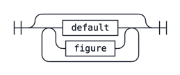

`figure`

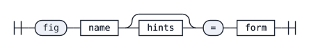

**Formulas**

`form`

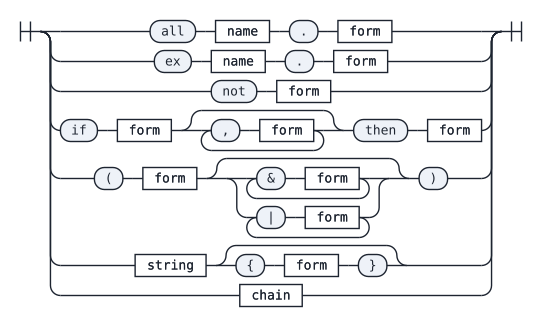

`chain`

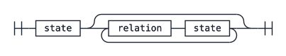

`state`

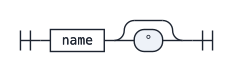

`relation`

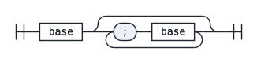

`base`

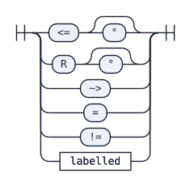

**Hints**

`hints`

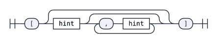

`hint`

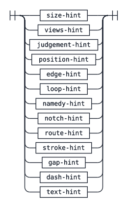

`size-hint`

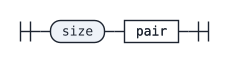

`views-hint`

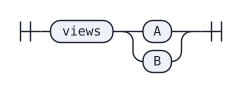

`position-hint`

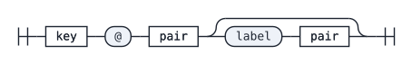

`edge-hint`

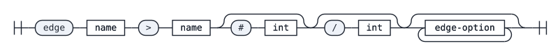

`edge-option`

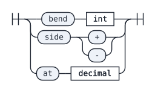

`loop-hint`

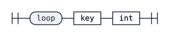

`namedy-hint`

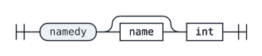

`judgement-hint`

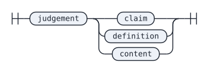

`text-hint`

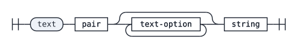

`text-option`

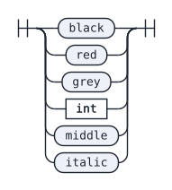

`key`

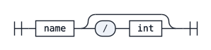

`pair`

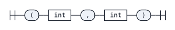

**Tokens**

`name`

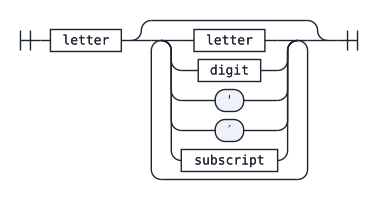

`letter`

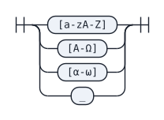

`digit`

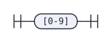

`subscript`

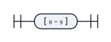

`int`

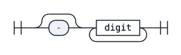

`decimal`

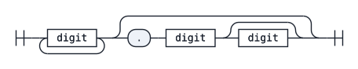

`string`

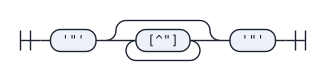

`labelled`

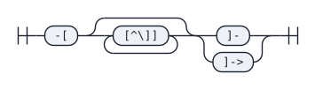


## Formulas

### Chains of relations

A chain `x₀ ρ₁ x₁ ρ₂ x₂ …` says `x₀ ρ₁ x₁ ∧ x₁ ρ₂ x₂ ∧ …`. Each `ρᵢ` is a
relation, drawn as one arrow.

| written | relation |
|---|---|
| `<=` | ≤, the order of the frame |
| `<=°` | ⊑: ≤ into an infallible state |
| `R` | the accessibility relation R |
| `R°` | R into an infallible state |
| `~>` | ⇝ = (≤ ∪ R)\*, reachability |
| `=`, `!=` | equality, inequality |
| `-[L]-`, `-[L]->` | a labelled relation L (undirected or directed), for relations the frame does not have; its meaning comes from the client |

A **composite** `ρ₁;ρ₂;…` is relational composition: `s <=;R t` says that
some state m has `s ≤ m` and `m R t`. It is drawn as one arrow whose stretches
change style. After a `<=°` or `R°` stretch the intermediate state is
infallible, drawn as a hollow bead.

A state written `x°` is **infallible** (the `°` may stand on any occurrence).
A chain may have no steps: `t°` on its own says that `t` is infallible.

```fgd
fig lang_chain = all y. all t. if s <=°;R;<= y° then (y R y & s ~> y & t°)
```

### Quantifiers, negation, implication

* `all x. φ` and `ex x. φ`: the body extends as far as it can (to the end of
  the enclosing form). Binders carry no `°`.
* `not φ`.
* `if φ₁, φ₂, …, φₙ then ψ` is `φ₁ → (φ₂ → … → ψ)`: the comma curries. A
  conjunction of hypotheses is written `if (φ₁ & φ₂) then ψ`, and an
  implication as a hypothesis `if (if φ then χ) then ψ`.

A name that no `all` or `ex` binds is a **free state**: the implicit outer
"for every infallible state".

```fgd
fig lang_quant = all t. if s <= t then ex u. (t R u° & not ex v. u R v)
fig lang_curried [views B] = if "A", "B" then "C"
fig lang_nested [views B] = if (if "A" then "B") then "C"
```

### Conjunction, disjunction, grouping

`(φ & ψ & …)` and `(φ | ψ | …)`, with at least two parts; `(φ)` only groups.
Disjunction is primitive (not encoded through `¬` and `→`). In view A each
disjunct after the first is drawn in a panel of its own, numbered 2, 3, …
(see hints below).

```fgd
fig lang_or [size (440,140), s@(30,100), t@(160,100), s/2@(280,100), u/2@(410,100)] =
  ex t. (s <= t | ex u. s R u)
```

### Text leaves

`"text"` is a leaf drawn as the text; `"text" {φ}` also gives its meaning,
a formula of this language (a leaf without one means True). Text leaves are
drawn in view B only.

```fgd
fig lang_text [views B] = all u. if s <= u°, "u is a dead end" {not ex x. u R x} then s <= u
```

## Hints

Hints shape the pictures; they never change the formula. (`judgement` says
what is done with the formula: claimed, defined, or only shown.) Each may be
given at most once per object; for `size`, `views`, `namedy` and `judgement`
the last one counts.

| hint | effect |
|---|---|
| `size (W,H)` | the canvas size of view A (default: large enough for the states) |
| `views A`, `views B` | draw only that view (default: both) |
| `judgement claim`, `judgement definition`, `judgement content` | the judgement stroke of view B (Begriffsschrift §2, §24): one stroke for a claim (the default, not printed), two for a definition, none for a content (a formula shown, nothing claimed). A definition must be `"D" {f}`: both views draw `f`, view B writes `D :≡` left of the strokes, and its LaTeX formula is `\text{D}\ :\equiv\ f` |
| `s@(X,Y)`, `s@(X,Y) label (DX,DY)` | position of state `s`, and of its name relative to it (default `(0,-10)`); `s/2@(…)` for state `s` of panel 2 |
| `edge a>b` + options | the arrow from `a` to `b`, named by the direction of its step in the formula; `#2` for the second such arrow (in the order of the formula), `/2` for panel 2. Options, in any order: `bend N` (signed, in units; positive curves to the right of the direction as drawn, negative to the left), `side +` or `side -` (which side its notch opens to), `at D` (where the notch sits, as a fraction of the arrow, default 0.35) |
| `loop s A` | the direction, in degrees, of a self-loop on `s` |
| `namedy N` | this figure's bound-name offset in the notches, both views (overrides `--notch-name-offset`) |
| `notch x up`, `notch x down` | view B: the notch of the binder `x` always opens up (or down); without it the side is the default (∀ up, ∃ down) or, with links, the router's choice |
| `route x (X,Y) (X,Y) …; (X,Y) …` | view B with links: the links of binder `x` are pinned to these polylines (in the tree's own coordinates, whole units, every segment horizontal or vertical) instead of being routed; the other binders are routed around them. Written by the editor. A pin holds for the layout it was made on: if the notch or the states have moved, it is reported and the links are routed automatically |
| `text (X,Y) …"caption"` | a caption: optional colour `black`, `red` or `grey` (default grey), size, `middle`, `italic`, in any order, then the text |

A hint that names nothing in the picture has no effect; `framediag --check`
and the editor report it.

```fgd
fig lang_hints [size (300,140), s@(30,100), y@(250,100) label (12,4),
    edge s>y bend -40 at 0.17, edge s>y#2 bend 12, loop y -90,
    text (150,130) grey 10 middle italic "a composite, a loop, reachability"] =
  all y. if s <=°;R;<= y° then (y R y & s ~> y)
```

A claim, a definition and a content:

```fgd
fig lang_claim [views B] = all t. if s <= u, u <= t then s <= t
fig lang_definition [views B, judgement definition] = "dead(u)" {not ex x. u R x}
fig lang_content [views B, judgement content] = ex u. (s <= u° & u R u)
```

## Printing and the round trip

`Fig.print` writes a figure in a canonical form (one hint per line, single
spaces, parentheses only where `&` and `|` need them). Parsing the printed
text gives the figure back: `parse (print d) = d` for every well-formed `d`
(names are names, strings contain no `"`, every `&` and `|` has two parts,
every `if` a hypothesis, every relation a stretch). This is **tested**, on the
examples and on 2000 pseudo-random figures, **not proved**. The converse holds
up to whitespace, comments and the order of hints of different kinds. The
editor does not reprint: it replaces only the characters of the hint it
changes.

## Errors

Errors give the line and column (counted in characters, from 1) and the next
few tokens:

```
line 4, column 27: expected 'then', at: ex s′ . ( s <=
line 3, column 17: a decimal has at most two fractional digits
```

In the editor, with a figure kept in a Lean string, the line in the file is
given as well.
