# Reading the pictures

Every figure is one formula drawn twice. **View A** is a frame picture: the
states and arrows of a Kripke frame that the formula talks about. **View B**
is a formula tree in the style of Frege's *Begriffsschrift* (1879). This
document says how to read both. How to write a figure is in
[LANGUAGE.md](LANGUAGE.md); every picture here is drawn by the tool from
[`examples/basic.fgd`](../examples/basic.fgd) or
[`docs/notation.fgd`](notation.fgd), and regenerated by `docs/tools/images.sh`.

```
all y. if s <=°;R;<= y° then (y R y & s ~> y)
```

| view A | view B |
|---|---|
| 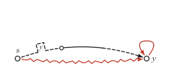 | 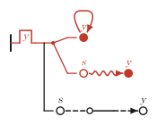 |

## Two conventions shared by both views

**Colour is polarity.** Red marks the positive parts of the formula, black
the negative ones. The figure as a whole is positive; a hypothesis of an
`if` and the body of a `not` reverse the polarity, and everything else keeps
the polarity of its place. Read roughly: black is what is assumed, red is what
is claimed.

**The free state.** A name that no quantifier binds (usually `s`) stands for
an arbitrary infallible state: the formula is claimed for every such state. It
is drawn hollow, has no notch, and gets no binding links. (Frege's Latin
letters play the same part: generality over the whole judgement.)

## View A: the frame picture

View A flattens the formula into one picture. Every step of every chain is an
arrow; equal names are one state; a step from a state back to itself is a
loop.

### The key

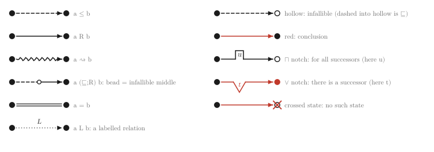

### States

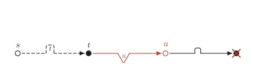

```
all t. if s <= t then ex u. (t R u° & not ex v. u R v)
```

*Every ≤-successor t of s sees an infallible dead end u.* The four kinds of
state:

| drawn | meaning | here |
|---|---|---|
| hollow | infallible: written `x°` somewhere, or the free state | `s`, `u` |
| filled | not said to be infallible | `t` |
| red | asserted to exist (an `ex` in a positive place) | `u` |
| crossed, no name | "there is no such state" (an `ex` under an odd number of `not`s) | `v` |

### Arrows

One line style per relation (see the key): `≤` dashed, `R` solid, `⇝` wavy,
`=` a double line, a labelled relation dotted with its label at the middle
(an arrowhead only when it is directed). Inequality `≠` is not drawn in view A.
These are the defaults: a file or a figure may dash a relation otherwise
(`default dash`, `dash`; [LANGUAGE.md](LANGUAGE.md#dashing)), in both views.

A **composite** relation such as `s (⊑;R;≤) y` is one arrow whose stretches
change style; a hollow **bead** after a `⊑` or `R°` stretch marks the
intermediate state as infallible. In the first picture above, the dashed,
solid and dashed stretches from `s` to `y` are `⊑`, `R` and `≤`.

### Notches: the quantifiers

A quantifier is drawn as a **notch** on the first arrow, after the quantifier,
into the state it binds; the bound name sits in the notch.

* `all x`: a square notch ⊓ (by default above a left-to-right arrow);
* `ex x`: a pointed notch ∨ (by default below), and a red state;
* `ex x` under an odd number of `not`s: "no such state", a crossed state with a
  square notch.

The notch makes the arrow a **guard**: in `n_states`, the ⊓ on `s → t` reads
"for every t with s ≤ t", the ∨ on `t → u` "there is a u with t R u".

When no arrow in its scope enters the state it binds (`all t. t R s`), a
quantifier has no arrow to sit on. It is then drawn on the state itself: a
short stroke under the state with the notch in it, opening downwards, read as
for an unguarded quantifier ("for every t"). Without it view A would not show
the quantifier at all (until 0.14.0 it did not).

View A is compact and deliberately not complete: two formulas can share a
view A, and some structure (the nesting of conditions, for one) is not shown.
View B is the canonical picture of a formula: it determines the formula, and
it is the one the editor aims to make fully editable.

**Where a notch sits along a composite arrow** matters when the arrow hides an
intermediate state of the other kind. The intermediate state of a composite is
universal in a negative place and existential in a positive one. Read the
arrow from its start: states before the notch are outside the quantifier,
states after it inside. So a ∀ notch on a red composite must stand before the
first bead:

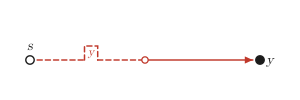

```
all y. s <=°;R y
```

reads "for every y, some intermediate m": correct. With the notch past the
bead the picture would read "some m, then every y", a stronger statement.
When the two kinds agree (a ∀ notch on a black arrow, an ∃ notch on a red
one) the place is free, since quantifiers of one kind commute.
`framediag --check` and the editor report a notch in the wrong place.

### Disjunction: panels

Each disjunct after the first is drawn in a panel of its own; the word "or"
between them is a caption.

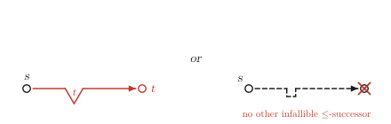

### What view A does not show

View A shows which states and relations a formula is about, and with colour
which parts are assumed and which claimed. It does not show the scope of the
quantifiers relative to each other and to the implications, text leaves, or
inequality. Two different formulas can have the same view A. **View B
determines the formula.**

## View B: the formula tree

View B follows Frege's two-dimensional notation, with the additions listed at
the end.

### Strokes

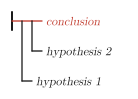

* The short vertical bar at the left is the **judgement stroke**: the whole
  figure is asserted (Begriffsschrift §2). See also *Claims, definitions,
  contents* below.
* The horizontal line from it is the **content stroke**; what it leads to is
  the content.
* `if H₁, H₂ then C` (that is H₁ → (H₂ → C)): `C` continues along the main
  stroke, and each hypothesis hangs below it on a **condition stroke** of its
  own, joined by a vertical line, the first hypothesis lowest and leftmost
  (§5).

How brackets show, with the same three parts:

| `if "A", "B" then "C"` | `if ("A" & "B") then "C"` | `if (if "A" then "B") then "C"` |
|---|---|---|
| 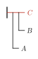 | 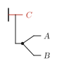 | 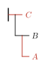 |
| two condition strokes | one hypothesis, a fork | a whole tree as the hypothesis |

### Negation, quantifiers, conjunction, disjunction

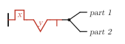

`all x. ex y. not ("part 1" & "part 2")`:

* a **negation** is a short tick below the stroke (§7);
* `all x` is a square notch ⊓ in the stroke with the bound name in it, where
  Frege writes a concavity with a German letter (§11);
* `ex y` is a pointed notch ∨; Frege has no sign for it and writes ¬∀¬;
* a **conjunction** is a fork whose rays start at a filled dot.

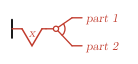

`ex x. ("part 1" | "part 2")`: a **disjunction** is a fork with a hollow dot
and an arc across its rays. (Neither conjunction nor disjunction is encoded
through `→` and `¬`: the encodings `¬A → B` for ∨ and `¬(A → ¬B)` for ∧ are
not valid in intuitionistic logic.)

### Claims, definitions, contents

| claim | definition | content |
|---|---|---|
| 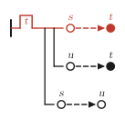 | 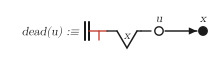 | 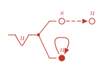 |
| one judgement stroke: the formula is asserted | two strokes: `dead(u)` is defined as what follows | no stroke: the formula is only shown |

A figure is a **claim** by default (in Lean, `#figure_claims` checks that
each claim has its theorem: MANUAL.md, section 6). A **definition** (`judgement definition`)
has Frege's double judgement stroke (§24) and the name it defines on its
left; its formula reads `dead(u) :≡ ¬∃x. u R x`. A **content**
(`judgement content`) has no judgement stroke: Frege's content stroke alone,
a content put forward without being judged (§2), for a formula displayed in
an argument but not claimed. View A draws all three alike.

### Leaves

At the end of each stroke is a leaf: a chain of relations, drawn as a small
strip of states and arrows in the style of view A (`s ⊑ · R · ≤ y` above), or a
text.

### Binding links (`--links`)

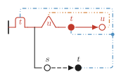

```
all t. if s <= t then ex u. t R u°
```

With `--links`, each notch is joined to every occurrence of the state it binds
by one tree of links, with a dot where it branches. Each binder has its own
pastel colour, and its links are dashed in the **Morse code of its name**
(dot 1.6 units, dash 5.5, with a short mark in the longer gaps), so that
binders stay distinct in black and white (a hint `dash x …` gives one
binder's links another pattern). Links run around the tree; to save
crossings the router may turn a notch over (⊔ for ∀, ∧ for ∃, as the ∃ notch
of `u` above). A figure can fix the side of a notch with the hint
`notch x up` or `notch x down`; the router then leaves that notch as it is and
routes the links around it. Links can also be laid out by hand in the
editor; they are then pinned in the figure (`route x …`), and the router
routes the other binders around them. The free state has no links. With `--hide-bound` the names
are left out and the links alone carry the binding.

## Where this notation departs from Frege's

| Frege (Begriffsschrift) | here |
|---|---|
| judgement stroke, content stroke, condition stroke, negation stroke | the same |
| double judgement stroke for a definition (§24), content stroke alone for an unjudged content (§2) | the same; the name defined is written `D :≡` to the left |
| generality: a concavity in the content stroke with a German letter | ⊓: a square notch with the name |
| no existential quantifier (¬∀¬) | ∨: a pointed notch |
| no conjunction or disjunction (through → and ¬) | forks: filled dot for ∧, hollow dot and arc for ∨ |
| Latin letters for generality over the whole judgement | the free state: hollow, no notch |
| letters and function expressions at the ends of strokes | chains of relations drawn as frame strips, or texts |
| one colour | colour as polarity: red positive, black negative |
| variables matched by their letters | optional binding links, coloured and dashed in Morse code |

View A has no counterpart in Frege: it is a picture of the frame, in the
manner of the diagrams used for Kripke semantics.

## References

G. Frege, *Begriffsschrift, eine der arithmetischen nachgebildete
Formelsprache des reinen Denkens*, Halle: L. Nebert, 1879; the section numbers
above are those of this work. More in [ACKNOWLEDGEMENTS.md](../ACKNOWLEDGEMENTS.md).
